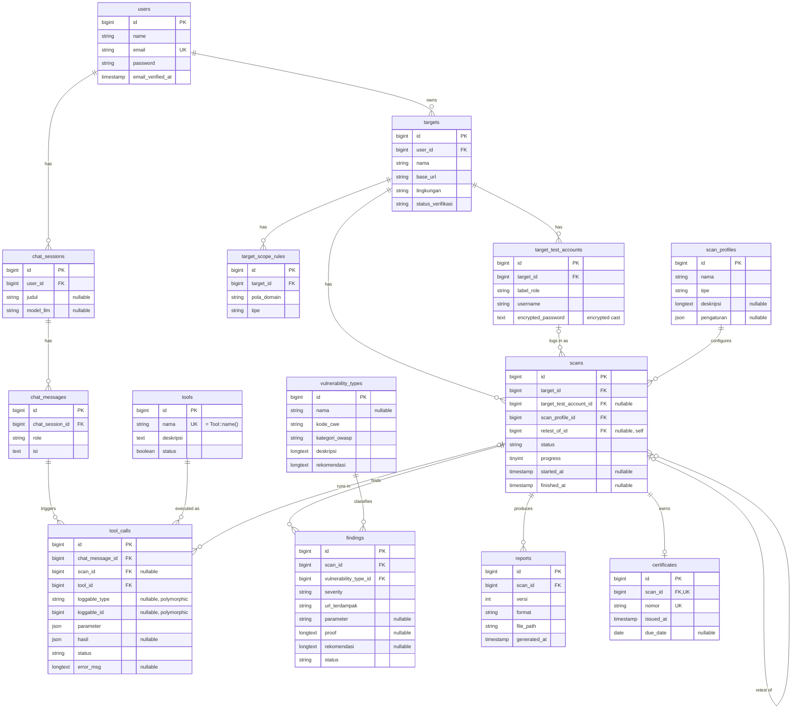

# PBKK Kelompok 4 — Agentic AI Desktop App

Final project PBKK (Pemrograman Berbasis Kerangka Kerja) TC ITS. Aplikasi asisten AI yang bisa memanggil *tools* secara otonom, dikemas sebagai aplikasi desktop dengan NativePHP.

Tema sementara: **Dynamic Application Security Testing (DAST)** — masih bisa berubah, jadi nama repo dan kerangka sengaja netral.

## Stack

| Komponen | Teknologi |
|---|---|
| Backend | Laravel 13 (PHP **8.4**) |
| Frontend | Blade + Livewire 3 (Volt, class API) |
| Auth | Laravel Breeze (stack Livewire) |
| Authorization | Spatie Laravel Permission (RBAC) |
| Database | SQLite + Eloquent |
| LLM | Senopati AI ITS (default) / Ollama (cadangan) — endpoint OpenAI-compatible |
| Tool execution | Action class (`App\Tools\Tool`) + Symfony Process |
| Background job | Laravel Queue (driver `database`) |
| Desktop | NativePHP Desktop (Electron) |
| Testing | Pest + `Http::fake()` |
| Code style | Pint, preset **PSR-12** |

## Tim & area

| Peran | Orang | Area (lihat `.github/CODEOWNERS`) |
|---|---|---|
| FE — Livewire UI & packaging | [@shzirley](https://github.com/shzirley) | `resources/`, `app/Livewire/`, `config/nativephp.php`, `NativeAppServiceProvider` |
| BE-1 — Data, Auth, RBAC, HTTP | [@Pardofel1s](https://github.com/Pardofel1s) | `database/`, `app/Models/`, `app/Http/`, `routes/` |
| BE-2 — LLM, Tools, Queue | [@build-zaidana](https://github.com/build-zaidana) | `app/Services/`, `app/Tools/`, `app/Jobs/`, `config/llm.php` |

`tests/`, `.github/`, dan README milik bersama. Tiap orang menulis test untuk area sendiri.

## Setup (Windows)

1. **PHP 8.4 + Composer.** Paling gampang pakai [Laravel Herd](https://herd.laravel.com/windows). Kalau pakai XAMPP, pastikan PHP-nya 8.4 dan aktifkan `extension=zip` di `php.ini` (wajib untuk NativePHP).
2. **Node.js 22+** dan **git**.
3. Clone & install:

   ```bash
   git clone https://github.com/Pardofel1s/pbkk-k4-agentic-ai.git
   cd pbkk-k4-agentic-ai
   composer run setup
   ```

   `setup` meng-copy `.env`, generate key, migrate SQLite, dan build asset.
4. Isi `LLM_API_KEY` di `.env` (minta ke grup, **jangan di-commit**). Mau pakai Ollama lokal? Ganti `LLM_BASE_URL=http://localhost:11434/v1` dan kosongkan key.
5. Jalankan:

   | Perintah | Untuk |
   |---|---|
   | `composer run dev` | Web di browser (server + queue + vite) |
   | `composer native:dev` | Jendela desktop NativePHP |
   | `composer test` | Semua test |
   | `vendor/bin/pint` | Rapikan kode ke PSR-12 |

> Path folder yang mengandung apostrof (mis. `Adinata's`) **dan** folder berawalan angka (mis. `5th Semester`) bikin Pest error `InvalidTestClassName`. Clone ke path biasa saja.

## Alur kerja Git

- **Tidak boleh commit langsung ke `main`** (diproteksi). Semua lewat Pull Request.
- Nama branch: `<tipe>/<area>-<deskripsi>`, contoh `feat/be1-chat-models`, `feat/fe-chat-ui`, `fix/be2-tool-injection`.
- Commit pakai [Conventional Commits](https://www.conventionalcommits.org/): `feat:`, `fix:`, `test:`, `docs:`, `chore:`.
- PR wajib **CI hijau** (`tests`: Pint + Pest) dan **semua checklist "Cek sebelum merge" dicentang** (`checklist`). Approval tidak wajib — boleh merge PR sendiri, tapi minta review kalau menyentuh area orang lain. Merge pakai **squash**, jadi `git log` di `main` = daftar kontribusi per orang (dinilai di UAS).

```bash
git switch main && git pull
git switch -c feat/be1-chat-models
# ...kerja, commit...
git push -u origin feat/be1-chat-models
gh pr create --fill
```

## Arsitektur

Modular monolith: Laravel MVC + service layer + agent tool-calling.

```
Livewire (chat UI) ──> Agent loop (BE-2) ──> LLM /chat/completions (Senopati/Ollama)
                              │  tool_calls
                              ▼
                       ToolRegistry ──> Tool (Action class) ──> Symfony Process
                              │                       (dijalankan via Queue Job)
                              ▼
                 ChatSession / ChatMessage / ToolExecutionLog (SQLite)
```

Kontrak yang sudah disediakan:

- `config/llm.php` — `base_url`, `model`, `api_key`, `timeout`, dan daftar `tools`.
- `App\Tools\Tool` — interface setiap tool: `name()`, `description()`, `parameters()` (JSON Schema), `handle()`.
- `App\Tools\ToolRegistry` — singleton dari `config('llm.tools')`; `schemas()` menghasilkan field `tools` untuk request LLM, `get($name)` menolak tool yang tidak terdaftar.

## Tugas Week 9 (kumpul link repo di LMS H-1 Pertemuan 10)

**BE-1 — @Pardofel1s**
- [x] Migration semua tabel (inti + DAST) dengan foreign key + `cascadeOnDelete()`
- [x] Model + relasi: User `hasMany` ChatSession → `hasMany` ChatMessage → `hasMany` ToolCall (dan `belongsTo` baliknya)
- [x] Factory + seeder data dummy relasional
- [x] Query riwayat chat dengan nested eager loading
- [ ] Screenshot Debugbar bebas N+1 (untuk slide)
- [x] (A+) `ToolCall` polymorphic: `nullableMorphs('loggable')`
- [x] ERD di bagian bawah README

**FE — @shzirley**
- [ ] Halaman daftar chat session + halaman chat (Volt), awalnya pakai data dummy/factory
- [ ] Coba `composer native:dev` jalan di laptop sendiri; set judul & ukuran window di `NativeAppServiceProvider`
- [ ] Test Livewire untuk halaman chat

**BE-2 — @build-zaidana**
- [ ] Service client LLM (`app/Services/Llm`) memanggil `{LLM_BASE_URL}/chat/completions` dengan `tools` dari `ToolRegistry`
- [ ] Test client LLM pakai `Http::fake()` (respons biasa + respons `tool_calls`)
- [ ] Rancang tool pertama sesuai tema (implements `Tool`, validasi argumen, Symfony Process bila perlu)

**Bersama:** slide pitch maks. 5 halaman / 5 menit.

## Menuju UAS (Week 16)

| Target | Pemilik |
|---|---|
| Chat Livewire berfungsi, loading state / polling | FE |
| `php artisan native:build win` → `.exe` jalan di laptop lain | FE |
| CRUD lengkap, RBAC Spatie (`HasRoles`, middleware `role:`/`permission:`), API Sanctum | BE-1 |
| Agent loop otonom, tools sesuai tema, mitigasi command injection, eksekusi via Queue | BE-2 |
| Minimal 5 skenario test lulus | Semua |

Rubrik UAS: demo **wajib** dari binary NativePHP (bukan browser), prompt → function calling → hasil tool. Siapkan cadangan Ollama `qwen3:14b` + video demo.

## Pertanyaan terbuka

- Tema final (DAST masih bisa berubah).
- Aplikasi target untuk diuji saat demo (mis. app fintech dummy / OWASP Juice Shop lokal) — DAST tidak boleh diarahkan ke sistem orang lain tanpa izin.
- Daftar role & permission RBAC.

## AI coding assistant

Repo ini sudah berisi guideline & skill resmi Laravel ([Laravel Boost](https://laravel.com/docs/boost)) untuk **Claude Code** (`CLAUDE.md`, `.claude/skills/`) dan **Codex** (`AGENTS.md`, `.agents/skills/`, `.codex/config.toml`), plus MCP server `laravel-boost`.

- Aturan tim untuk agent ada di `.ai/guidelines/team.md`. Setelah mengubahnya atau update package, jalankan `php artisan boost:update`.
- Jangan edit `CLAUDE.md` / `AGENTS.md` langsung — file itu digenerate.

## ERD

Model inti Week 9: `User` → `ChatSession` → `ChatMessage` → `ToolCall` (= *ToolExecutionLog* di slide). Sisanya domain DAST.



Semua tabel juga punya `created_at`/`updated_at`.

- **Polymorphic (A+):** `tool_calls.loggable` = subjek yang dikenai tool, saat ini `Target` atau `Finding` (`morphMany('loggable')`). Tambah model lain cukup dengan relasi `morphMany` baru.
- **onDelete:** relasi kepemilikan `cascade` (user → chat/target → scan → finding/report/certificate, message → tool call). Tabel lookup (`tools`, `scan_profiles`, `vulnerability_types`) `restrict`. `scan_id`, `target_test_account_id`, `retest_of_id` → `set null`.
- **Bebas N+1:** `ChatSessionController@show` memuat `chatMessages.toolCalls.tool` + `chatMessages.toolCalls.loggable` sekaligus; `Model::preventLazyLoading()` aktif di luar production, dan `tests/Feature/Database/SchemaTest.php` memastikan jumlah query konstan. Screenshot Debugbar: `php artisan migrate:fresh --seed`, login `test@example.com` / `password`, buka `/chat-sessions/1`.
